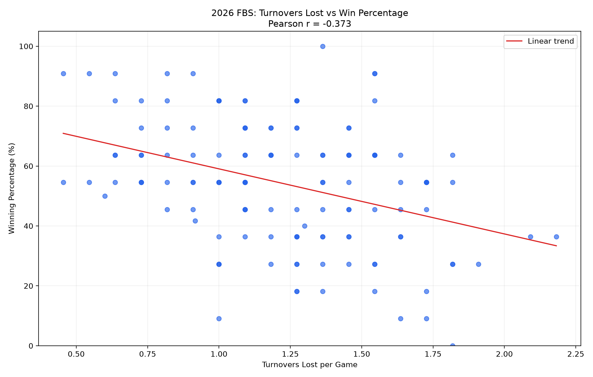
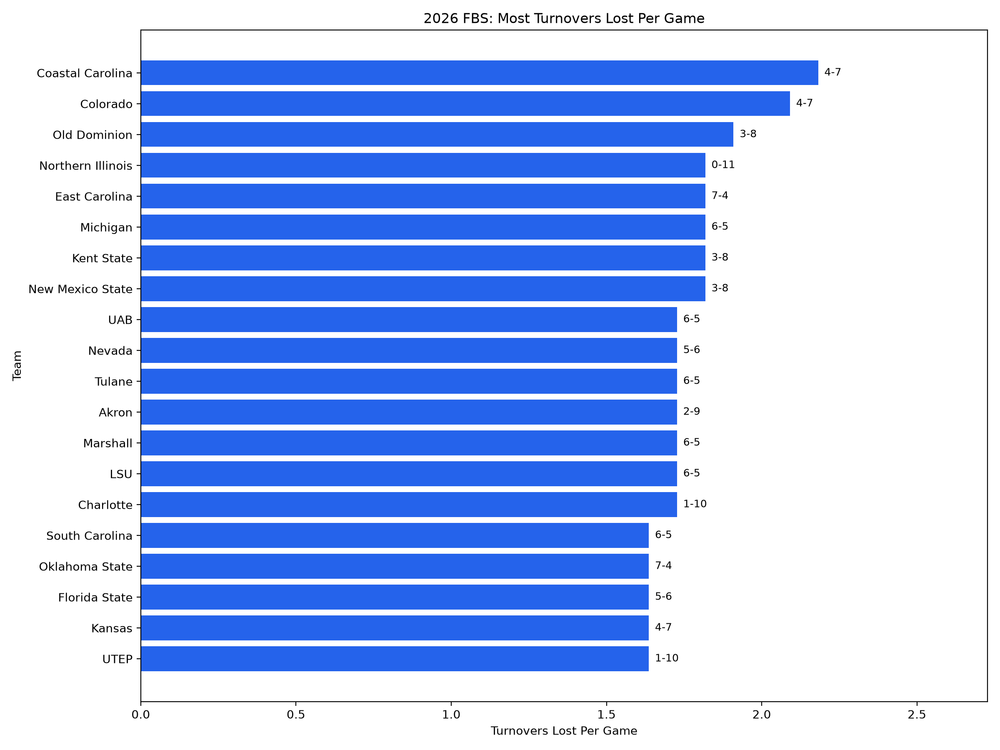

# College Football Turnover Analysis

## Overview

This Python project investigates the relationship between turnovers lost and winning percentage among NCAA Division I FBS football teams during the 2026 season.

## Research Question

Do college football teams that lose more turnovers per game tend to have lower winning percentages?

## Technologies Used

- Python
- Requests
- BeautifulSoup
- Pandas
- Matplotlib
- Visual Studio Code

## Methodology

1. Scrape team turnover statistics from CFBStats.
2. Collect team win-loss records from D1SportsNet.
3. Standardize team names and combine the datasets.
4. Validate team records and game counts.
5. Calculate turnovers lost per game.
6. Calculate Pearson's correlation between turnovers lost per game and winning percentage.
7. Generate visualizations showing team performance.

## Data Sources

- [CFBStats](https://cfbstats.com/)
- [D1SportsNet](https://d1sportsnet.com/)

The analysis uses 2026 season data and should be rerun as additional games are completed.

## Results

The program generates:

- A scatterplot comparing turnovers lost per game and winning percentage.
- A bar chart of the 20 teams with the highest turnover rates.
- A CSV containing the combined team statistics.

## Visualizations

### Turnovers Lost vs. Winning Percentage

This scatterplot examines the relationship between
turnovers lost per game and team winning percentage
during the 2026 college football season.

### Top 20 Teams by Turnovers Lost

This chart shows the 20 FBS teams with the highest
turnovers lost per game, alongside their win-loss records.

### Dataset

[View the Complete Dataset](cfb_2026_analysis.csv)

### Findings

Add the actual correlation coefficient, number of teams analyzed, and interpretation after verifying the output.

## Limitations

- Correlation does not establish causation.
- Turnovers are only one factor affecting game outcomes.
- Results depend on the accuracy and update timing of the source websites.
- The analysis uses team-level statistics rather than individual game outcomes.

## AI-Assisted Development

This project was developed using Python and AI-assisted coding with ChatGPT. I reviewed and tested the generated code, refined the data collection process, and used the results to investigate my research question.
